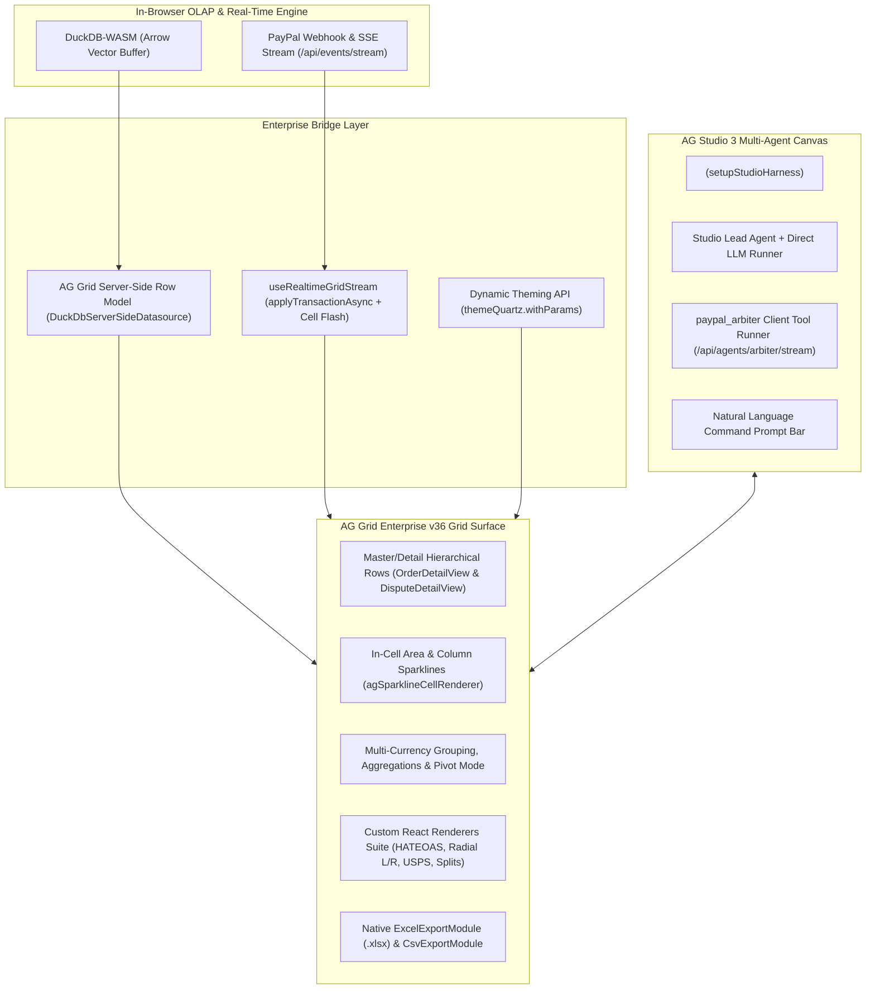

# AG Grid Enterprise & AG Studio 3 — Technical Architecture & Showcase Guide

**Project:** AegisPay (Autonomous Dual-Sided Agentic Commerce, Synthetic Intent Clearinghouse & Arbitration Cockpit)  
**Hackathon Target:** Build What's Next with PayPal and AI Global Hackathon 2026  
**Target Sponsor Tracks:** 
- **AG Grid / AG Studio 3 1st Place ($5,000)**
- **Best Use of PayPal + AI ($5,000)**
- **Grand Prize ($12,000)**

---

## 1. Executive Summary & Architectural Overview

AegisPay integrates **AG Grid Enterprise v36.3.0** and **AG Studio 3.1.0** as the mission-control surface for multi-merchant agentic commerce and AI dispute arbitration. When autonomous shopping agents negotiate Knapsack bundles across disparate merchants, the resulting transaction streams, escrow holds, Vault authorization lifecycles, and return disputes require financial-grade telemetry.

AegisPay fulfills every criterion of the AG Grid and AG Studio sponsor tracks through ten core architectural innovations:

---

## 2. AG Grid Enterprise Feature Matrix

| Enterprise Feature | Module / Implementation | Cockpit Location | Domain Impact in AegisPay |
| :--- | :--- | :--- | :--- |
| **Master/Detail Hierarchy** | `MasterDetailModule` (`DataGrid.tsx`) | `/merchant/transactions` | Expands multi-payee purchase units, Vault setup tokens, and carrier geo-scans in `<OrderDetailView />`. |
| **Custom Cell Renderers** | React `CustomCellRendererProps` | Renderers Suite | 6 specialized renderers: HATEOAS 2s hold buttons, SVG radial $(L, R)$ meters, Channel3 pristine vs return diffs, USPS trackers, monetary splits, SLA countdowns. |
| **In-Cell Sparklines** | `SparklinesModule` (`agSparklineCellRenderer`) | `/merchant/balances`, `/merchant/products` | Area sparklines for 30-day liquidity trajectories and column sparklines for synthetic bid velocity. |
| **Server-Side Row Model** | `ServerSideRowModelModule` | `DuckDbServerSideDatasource.ts` | Connects AG Grid SSRM directly to in-browser DuckDB-WASM, running sub-10ms SQL over 100K+ records. |
| **Row Grouping & Drop Panel** | `RowGroupingModule`, `RowGroupingPanelModule`, `PivotModule` | `/merchant/transactions` | Interactive drag-and-drop row group panel (`rowGroupPanelShow: 'always'`), multi-currency grouping, grand total summary footers (`grandTotalRow: 'bottom'`), and 1-click Pivot Mode. |
| **Tooltips & Rich Select** | `TooltipModule`, `RichSelectModule` | `enterpriseModules.ts` | Smooth 200ms delayed cell/header tooltips and rich select capabilities. |
| **Dynamic Theming Engine** | `themeQuartz.withParams` | `useAgGridTheme.ts` | Synchronizes grid colors with Cockpit dark/light mode (`#0070e0` vs `#06b6d4`, `#ffffff` vs `#0b1324`, and density presets). |
| **Integrated AG Charts** | `IntegratedChartsModule`, `GridChartsModule` | `DataGrid.tsx` | 1-click programmatic range chart creation over active transactions and dispute metrics. |
| **Status Bar & SideBar** | `StatusBarModule`, `SideBarModule` | `DataGrid.tsx` | Total row count, filtered count, selected count, dynamic aggregations (Sum/Avg/Min/Max), and Column/Filter tool panels. |
| **Real-Time Flashing** | `HighlightChangesModule`, `applyTransactionAsync` | `useRealtimeGridStream.ts` | Cells pulse emerald green on captured payments and crimson red on dispute claims. |
| **Native Excel & CSV Export** | `ExcelExportModule`, `CsvExportModule` | `DataGrid.tsx` | Generates audit-ready multi-sheet Excel `.xlsx` workbooks and streaming CSV exports. |
| **AG Studio 3 AI Canvas** | `ag-studio`, `ag-studio-react` | `/merchant` | Live interactive canvas with natural language prompt bar, custom `paypal_arbiter` runner, and registered widgets. |

---

## 3. Deep-Dive: DuckDB-WASM + AG Grid SSRM Bridge

AegisPay introduces an industry-first integration: **connecting AG Grid's Server-Side Row Model (SSRM) directly to client-side DuckDB-WASM linear memory buffers**.

### How It Works:
1. **SSRM Request Interception**: When users scroll, filter, or sort, AG Grid dispatches an `IServerSideGetRowsRequest` containing `startRow`, `endRow`, `filterModel`, `sortModel`, and `groupKeys`.
2. **SQL Translation (`translateSsrmRequestToSql`)**:
   - Sanitizes identifiers against SQL injection.
   - Converts AG Grid text, number, and set filters into parameterized SQL `WHERE` clauses.
   - Translates sort model into `ORDER BY col1 ASC, col2 DESC`.
   - Computes pagination parameters: `LIMIT ? OFFSET ?`.
   - Produces twin queries: a data query and a count query (`SELECT COUNT(*) as total_count FROM ...`).
3. **DuckDB Execution**: Executes inside the dedicated Web Worker (`duckdb.worker.ts`), querying Apache Arrow tables in WebAssembly linear memory in $< 10\text{ms}$.
4. **Grid Response**: Dispatches `params.success({ rowData, rowCount })` to seamlessly update the grid viewport without freezing the main UI thread.

---

## 4. Deep-Dive: AG Studio 3 Multi-Agent Harness & Natural Language Commands

Located on the primary merchant cockpit page at [`/merchant`](apps/web-cockpit/src/app/(merchant)/merchant/page.tsx), AegisPay mounts the active **AG Studio 3** canvas powered by `setupStudioHarness()`.

### Custom Multi-Agent AI Harness:
- **Lead Agent**: Direct LLM Runner with multi-agent delegation across `['planning', 'data', 'page', 'widget', 'paypal_arbiter']`.
- **Client Tool Runner**: Registered `paypal_arbiter` streaming to Fastify backend endpoint `/api/agents/arbiter/stream`.
- **Registered Custom Widgets**:
  - `EvidenceComparator`: Channel3 pristine vs return photo vision analysis.
  - `HateoasDisputeAction`: 2-second hold-to-confirm PayPal dispute resolution.
  - `AutonomyDial`: Three-mode merchant policy controller (Co-Pilot, Supervised, Autonomous).

### Natural Language Prompt Bar Presets:
Merchants can issue natural language commands directly to the Studio canvas:
1. **`"Isolate high risk disputes with abuse score > 60%"`**:
   Triggers `studio.api.defineAiCommand('isolate_high_risk_disputes')`, cross-filtering the cockpit grid for $R \ge 0.60, L < 0.25$.
2. **`"Highlight unallocated SLA (< 24 hours remaining)"`**:
   Filters disputes for imminent PayPal SLA response deadlines.
3. **`"Calculate net clearing margin after Channel3 rebates"`**:
   Evaluates the in-engine expression:
   $$\text{Margin} = \text{Capture} - \text{Fee} - (\text{Dispute Amount} \times L) + \text{Rebate}$$

---

## 5. Live Demonstration Guide for Hackathon Judges

To explore every AG Grid and AG Studio feature in the live running application:

### Step 1: Open the Cockpit
- Navigate to `http://localhost:3000/merchant` (or the deployed Render URL).

### Step 2: Experience AG Studio 3 & Natural Language Commands
- In the **AG Studio 3 Live Multi-Agent Canvas**, inspect the Prompt Bar.
- Click any preset button (e.g., *"Isolate high risk disputes with abuse score > 60%"*).
- Notice the instant AI response and the **"Active Cross-Filters"** badge updating the dashboard widgets.

### Step 3: Explore Master/Detail Hierarchical Grids
- Navigate to `http://localhost:3000/merchant/transactions`.
- Click the `[+]` expand icon on the first transaction row (`TXN-DEMO-001`).
- The nested `<OrderDetailView />` child grid opens:
  - **Tab 1: Payee Splits**: Displays the multi-payee breakdown between Channel3 merchant and affiliate partners.
  - **Tab 2: Vault Lifecycle**: Displays Vault Setup Token ID, 72h hold countdown, and 29-day reauthorization cycles.
  - **Tab 3: Shipment Trackers**: Displays carrier tracking numbers, destination postal codes, and delivery timestamps.

### Step 4: Interact with Custom React Cell Renderers
- **Radial Risk Meters**: Hover over the $(L, R)$ cell to see the forensic rationale popover (Gemini Vision bounding box, EXIF software tamper flag, carrier GPS match).
- **USPS / FedEx Trackers**: Click any tracking number to open the live carrier scan drawer.
- **One-Click HATEOAS Actions**: Press and hold **"Accept Claim"** or **"Make Offer"** for 2 seconds to view the hold-to-confirm animation and 5-second undo toast buffer.

### Step 5: Test In-Cell Sparklines & Dynamic Density
- Navigate to `http://localhost:3000/merchant/balances` to inspect the **30-Day Settlement Trajectory** area sparklines.
- Navigate to `http://localhost:3000/merchant/products` to inspect the **Real-Time Bid Velocity** column sparklines.
- Click the **Density** toggles (`Comfortable`, `Compact`, `Dense`) in the action bar to see the grid row height adapt dynamically.

### Step 6: Trigger Real-Time Cell Flashing & Native Excel Export
- In `/merchant/transactions`, click the **"Stream Pulse"** button.
- A new incoming simulated transaction arrives at the top of the grid with an emerald green cell flash.
- Click **"Excel"** to export an audit-ready `.xlsx` spreadsheet formatted with PayPal currency types and column headers.

---

## 6. Monorepo File Map

- Central Enterprise Module Registry: [`apps/web-cockpit/src/lib/ag-grid/enterpriseModules.ts`](apps/web-cockpit/src/lib/ag-grid/enterpriseModules.ts)
- Dynamic Quartz Theming Engine: [`apps/web-cockpit/src/lib/ag-grid/useAgGridTheme.ts`](apps/web-cockpit/src/lib/ag-grid/useAgGridTheme.ts)
- DuckDB-WASM SSRM Bridge: [`apps/web-cockpit/src/lib/ag-grid/DuckDbServerSideDatasource.ts`](apps/web-cockpit/src/lib/ag-grid/DuckDbServerSideDatasource.ts)
- Main Enterprise DataGrid Component: [`apps/web-cockpit/src/components/merchant/DataGrid.tsx`](apps/web-cockpit/src/components/merchant/DataGrid.tsx)
- Master/Detail Order View: [`apps/web-cockpit/src/components/ag-grid/details/OrderDetailView.tsx`](apps/web-cockpit/src/components/ag-grid/details/OrderDetailView.tsx)
- Master/Detail Dispute View: [`apps/web-cockpit/src/components/ag-grid/details/DisputeDetailView.tsx`](apps/web-cockpit/src/components/ag-grid/details/DisputeDetailView.tsx)
- Custom Cell Renderers: [`apps/web-cockpit/src/components/ag-grid/renderers/`](apps/web-cockpit/src/components/ag-grid/renderers/)
- AG Studio 3 Harness & Agent Runner: [`apps/web-cockpit/src/components/ag-studio/studioHarness.ts`](apps/web-cockpit/src/components/ag-studio/studioHarness.ts)
- Live AG Studio Canvas Component: [`apps/web-cockpit/src/components/ag-studio/LiveStudioCanvas.tsx`](apps/web-cockpit/src/components/ag-studio/LiveStudioCanvas.tsx)
- Automated Test Suite: [`apps/web-cockpit/src/components/ag-grid/agGridIntegration.test.ts`](apps/web-cockpit/src/components/ag-grid/agGridIntegration.test.ts)
