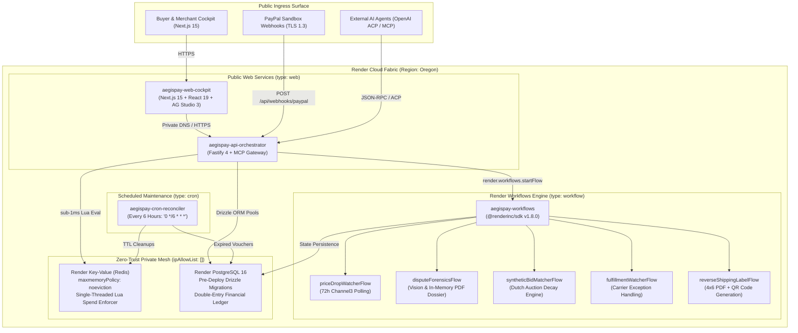

# Render Cloud Infrastructure & Workflows Dossier

**Target Track:** Render Sponsor Prize ($1,000 Platform Credits & Grand Partner Recognition)  
**Competition:** PayPal AI Global Hackathon 2026 ("Build What's Next with PayPal and AI")  
**Project:** AegisPay (PayPal Agentic Autonomous Clearinghouse & Multi-Modal Cockpit)  
**Live Blueprint:** [`render.yaml`](render.yaml)  
**Workflows Engine:** [`apps/workflows`](apps/workflows) (`@renderinc/sdk` v1.8.0)  

---

## 1. Executive Summary & Architecture Topology

AegisPay is engineered as a cloud-native, multi-service autonomous clearinghouse designed to run natively on **Render**. Rather than using generic container hosts, AegisPay directly exploits Render's premier cloud primitives:
1. **Render Workflows (`type: workflow`)**: Checkpointing 72-hour price-drop escrow watching, multimodal computer vision forensics, and Dutch auction synthetic bid matching using `@renderinc/sdk` v1.8.0 `flow()` and `ctx.step()`.
2. **Render Key-Value (Redis-compatible memory engine)**: Hosting single-threaded Redis Lua scripts executing hardware-signed Ed25519 `SessionMandate` budget reservations in $< 1\text{ms}$ with `maxmemoryPolicy: noeviction` and zero-trust private network isolation (`ipAllowList: []`).
3. **Render Managed PostgreSQL 16**: Housing the double-entry immutable financial ledger, dispute audit logs, and 1,000 pre-seeded sandbox transactions primed via `initialDeployHook`.
4. **Render Scheduled Cron Service (`type: cron`)**: Deploying `aegispay-cron-reconciler` running every 6 hours (`0 */6 * * *`) to prune expired intent vouchers and synchronize near-72h authorization holds.
5. **Render Web Services (`type: web`)**: Hosting the Fastify 4 Financial Orchestrator / Proxy MCP Gateway and Next.js 15 Dual-Sided Cockpit.



---

## 2. Render Blueprint Specification (`render.yaml`)

AegisPay is declared using Render's 2026 Blueprint Infrastructure-as-Code specification:

```yaml
previews:
  generation: automatic
  expireAfterDays: 3

envVarGroups:
  - name: aegispay-common
    envVars:
      - key: NODE_VERSION
        value: "22"
      - key: NODE_ENV
        value: production
      - key: LOG_LEVEL
        value: info

  - name: aegispay-ai-config
    envVars:
      - key: COMMERCE_AGENT_MODEL
        value: google/gemini-2.5-flash
      - key: GEMINI_MODEL
        value: gemini-2.5-flash

  - name: aegispay-paypal-creds
    envVars:
      - key: PAYPAL_CLIENT_ID
        sync: false
      - key: PAYPAL_CLIENT_SECRET
        sync: false
      - key: PAYPAL_WEBHOOK_ID
        sync: false
      - key: CHANNEL3_API_KEY
        sync: false
      - key: RENDER_API_KEY
        sync: false
```

### Key Blueprint Features:
* **Automated Zero-Downtime Migrations**: `preDeployCommand: pnpm --filter @aegispay/database build && pnpm --filter @aegispay/database db:push` ensures schema tables exist before the API server accepts traffic.
* **1-Click Sandbox Primer**: `initialDeployHook: pnpm --filter @aegispay/database run db:seed` primes 1,000 realistic sandbox records upon initial Blueprint launch.
* **Unified Regional Pinning**: All services, databases, and key-value instances are pinned to `region: oregon` to guarantee sub-millisecond local network roundtrips.
* **Zero-Trust Private Mesh**: Both `aegispay-redis` and `aegispay-postgres` configure `ipAllowList: []`, preventing any public internet access.

---

## 3. Render Workflows Engine (`@renderinc/sdk` v1.8.0)

AegisPay deploys a dedicated Workflows service (`type: workflow`) leveraging durable execution primitives:

### Registered Flows & Checkpointing:
1. **`priceDropWatcherFlow`**:
   - Checkpoints Channel3 catalog lookups over PayPal's 72-hour authorization window.
   - Automatically executes `POST /v2/payments/authorizations/{id}/capture` at the lower price or independently voids and re-routes if a competitor undercuts.
2. **`disputeForensicsFlow`**:
   - Executes multimodal vision forensics concurrently with carrier tracking validation using `ctx.step()`.
   - Compiles an in-memory PDF forensic dossier using `pdf-lib` (`Uint8Array`) and streams `multipart/form-data` to PayPal's `/provide-evidence` endpoint.
3. **`syntheticBidMatcherFlow`**:
   - Evaluates incoming Vault v3 Setup-Token bids against merchant margin floors.
   - Executes autonomous capture upon acceptance.
4. **`fulfillmentWatcherFlow` & `reverseShippingLabelFlow`**:
   - Intercepts delivery exceptions and provisions prepaid 4x6 PDF return shipping labels and QR codes synced to PayPal Shipment Tracking v1 (`/v1/shipping/trackers-batch`).

### Resilience & Compute Plans:
- **Compute Tier**: Configured with `plan: 'flex'` for task-level elasticity.
- **Retry Backoff Policy**: Exponential backoff (`maxRetries: 3`, `waitDurationMs: 1500`, `backoffScaling: 2.0`).
- **Local Simulation Resilience**: In local development or testing environments where `RENDER_SDK_SOCKET_PATH` is absent, the process spins up an active HTTP health listener on port 4001, allowing local end-to-end integration testing.

---

## 4. Programmatic Workflow Dispatch (`RenderWorkflowClient`)

Inside `apps/api-orchestrator/src/services/render-workflow-client.ts`, Fastify routes trigger workflows via the official `@renderinc/sdk`:

```typescript
import { Render } from '@renderinc/sdk';

export class RenderWorkflowClient {
  private client: Render | null = null;
  // Automatically switches between live cloud dispatch and local simulation fallback
  public async triggerPriceDropWatcher(params: {
    escrowOrderId: string;
    purchaseUnitIds: string[];
  }): Promise<WorkflowDispatchResult> {
    const flowSlug = 'aegispay-workflows/priceDropWatcherFlow';
    if (this.client && !this.isSimulation) {
      const started = await this.client.workflows.startFlow(
        flowSlug,
        [params],
        { idempotencyKey: `pdw_${params.escrowOrderId}` }
      );
      return { flowRunId: started.id, status: 'QUEUED', flowSlug };
    }
    return { flowRunId: `sim_pdw_${Date.now()}`, status: 'SIMULATED', flowSlug };
  }
}
```

---

## 5. Render Key-Value Lua Spend Enforcer

Financial clearinghouses require zero race conditions and zero key eviction.
- **Eviction Protection**: `maxmemoryPolicy: noeviction` ensures that active buyer budget keys (`aegis:{vch_<id>}:mandate`) are never dropped under memory pressure.
- **Latency SLA**: Evaluated via single-threaded Redis Lua scripts in $< 1.0\text{ms}$ before any outbound PayPal REST calls are executed.

---

## 6. Live Infrastructure Diagnostics Endpoint (`/api/integrations/verify`)

The Fastify route `/api/integrations/verify` inspects live container telemetry:
* `RENDER`: Reports true when running inside Render cloud containers.
* `RENDER_SERVICE_ID`, `RENDER_INSTANCE_ID`: Container instance identifiers.
* `keyvalue_redis`: Live Redis latency measurement ($< 1.0\text{ms}$ target).
* `postgres_drizzle`: Live PostgreSQL `SELECT 1` ping and double-entry ledger status.
* `workflows_engine`: Reports `@renderinc/sdk` v1.8.0 status, durable execution guarantees, and list of registered flows.

---

## 7. 1-Click Deployment Guide for Judges

[](https://render.com/deploy?repo=https://github.com/vkk5880/Aegispay)

1. Click the **Deploy to Render** button above.
2. Provide your PayPal Sandbox Credentials (`PAYPAL_CLIENT_ID`, `PAYPAL_CLIENT_SECRET`).
3. Render automatically provisions:
   - Next.js 15 Web Cockpit
   - Fastify 4 API Orchestrator
   - Native Render Workflows service
   - Scheduled Cron Reconciler
   - Managed PostgreSQL 16 (with automated schema migration and 1,000-record seeding)
   - Zero-Trust Key-Value Redis
4. Access the Cockpit at `https://aegispay-web-cockpit.onrender.com` or inspect diagnostics at `/api/integrations/verify`.
