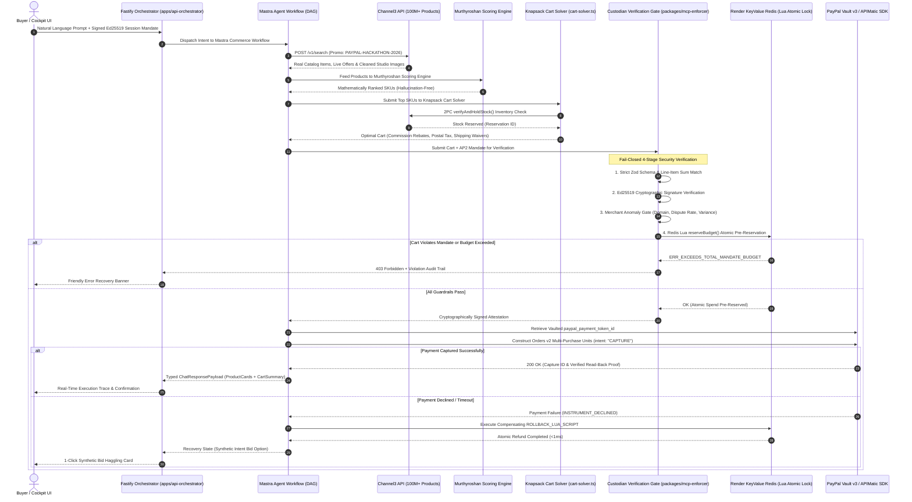

# MASTER ENGINEERING EXECUTION BLUEPRINT (`master_engineering_execution_blueprint.md`)
## Production-Ready Autonomous Payment Cockpit & Clearinghouse Pipeline

**Project Codename:** AegisPay — Autonomous Dual-Sided Agentic Commerce, Synthetic Intent Clearinghouse & Arbitration Cockpit  
**Target Competition:** Build What's Next with PayPal and AI Global Hackathon (Deadline: Nov 12, 2026)  
**Total Target Prize Pool:** $34,500+ across PayPal Core Tracks & Sponsor Awards (Channel3, APIMatic, AG Grid, Bryntum, Render)  
**Core Framework Decision:** **Mastra (`@mastra/core`)** within a 100% Unified TypeScript Monorepo  
**Payment Infrastructure:** **100% PayPal Native** (Vault v3, Orders v2 Multi-Purchase Units, Disputes v1, Tracking v1) — *Zero Stripe / External Payment Dependencies*  
**Catalog & Auto-Buy Engine:** **100% Channel3** (100M+ real multi-vendor products, promo `PAYPAL-HACKATHON-2026`) — *Zero Medusa Mock Backend*

---

## 1. Reference Repository Audit & Harvest Protocol

To ensure that **not a single architectural point, mathematical detail, or security rule is missed**, every Jules worker agent is required to follow a mandatory **Two-Step Inspection & Implementation Protocol**:

```
[Step 0: Mandatory Clone & Audit]
  │  Clone reference repo locally into .reference-repos/<repo-name>
  │  Examine EVERY file, mathematical formula, schema, and error condition
  │  Extract complete point-by-point feature checklist
  ▼
[Step 1: Production Refinement & Adaptation]
  │  Translate/port 100% of extracted logic into clean, type-safe TypeScript
  │  Bind directly to Zod schemas in packages/shared-types
  │  Wire into our Redis Lua atomic locks and PayPal Vault rails
  ▼
[Step 2: Automated Verification Gate]
  │  Verify against dedicated node:test test suite (check_file)
  │  Confirm zero regressions across Turborepo build
```

### Reference Repositories to be Cloned and Audited Point-by-Point:

| Reference Repository | Clone Destination | Exact Points to Examine & Harvest | Our Implementation Target |
| :--- | :--- | :--- | :--- |
| **`murthyroshan/autonomous-commerce-agent`** | `.reference-repos/autonomous-commerce-agent` | • Multi-attribute composite utility formula: Cosine semantic relevance + price affinity distance + merchant credibility + shipping latency penalty.<br>• Query intent extraction prompts & facet parsing.<br>• Deterministic SKU ranking rules (zero LLM math hallucinations). | `apps/api-orchestrator/src/services/scoring-engine.ts` |
| **`OkayAnshul/custodian`** | `.reference-repos/custodian` | • Declarative AP2 (Agent Payment Protocol) Intent Mandate schema.<br>• Strict boolean verification gate & policy-as-code evaluation.<br>• Rule violation taxonomy (budget overage, unapproved add-on warranties, blacklisted merchants). | `packages/mcp-enforcer/src/custom-tools.ts`<br>`packages/shared-types/src/index.ts` |
| **`agentic-commerce-protocol/agentic-commerce-protocol`** | `.reference-repos/agentic-commerce-protocol` | • Complete OpenAPI specs for `GET /.well-known/acp.json`, `POST /acp/checkout_session`, `POST /acp/payment_handler`, and `POST /api/acp/actions`.<br>• Request/response payload contracts, tax/shipping schemas, and session state lifecycles. | `apps/api-orchestrator/src/routes/acp.routes.ts`<br>`packages/mcp-enforcer/src/acp-manifest.ts` |
| **`x402-foundation/x402` & `google-agentic-commerce/a2a-x402`** | `.reference-repos/x402` | • RFC-compliant HTTP 402 challenge headers (`Pay-To`, `X-Payment-Contract-Id`, currency units).<br>• Cryptographic micro-settlement receipt headers (`Authorization: x402 <receipt>`).<br>• Autonomous agent retry logic upon receiving 402. | `apps/api-orchestrator/src/middleware/http402-interceptor.ts` |
| **`mastra-ai/mastra`** | `.reference-repos/mastra` or `@mastra/core` | • Graph-based Agent Workflows (DAGs), step-level execution state machines, typed tool calling, and telemetry hooks.<br>• Strict Zod schema output formatting with Gemini 3.8 Flash (`@mastra/ai`). | `apps/api-orchestrator/src/services/shopping-assistant.ts` |

---

## 2. 100% Sponsor Track Feature Coverage Matrix

Every capability required to win all 7 sponsor tracks ($34,500+ prize pool) is rigorously specified and implemented:

### 2.1 PayPal Core Tracks ($27,000 Combined Prizes)
1. **Multi-Purchase Unit Orders v2 (`POST /v2/checkout/orders`):**
   * Splitting a single buyer basket across multiple independent merchants under one unified PayPal authorization hold (`intent: "AUTHORIZE"`).
   * Verified server read-back verification via `GET /v2/checkout/orders/{id}` ensuring zero phantom authorizations.
2. **PayPal Vault v3 Autonomous Pre-Authorization:**
   * One-time consumer onboarding via `POST /v3/vault/setup-tokens` with `usage_type: "MERCHANT"` and `customer_type: "CONSUMER"`.
   * Conversion into durable `paypal_payment_token_id` (`POST /v3/vault/payment-tokens`).
   * Fully autonomous checkout execution via ACP `/acp/payment_handler` with **zero human intervention**.
3. **12-Action Disputes v1 API Coverage:**
   * Full coverage of PayPal Disputes v1: `/provide-evidence` with in-memory `multipart/form-data` PDF compilation (`pdf-lib`), `/make-offer`, `/acknowledge-return-item`, `/accept-claim`, and sandbox transitions (`/require-evidence`, `/adjudicate`).
   * Instant partial refunds via Captures Refund v2 (`/v2/payments/captures/{id}/refund`).
4. **Shipment Tracking v1 (`POST /v1/shipping/trackers-batch`):**
   * Automatic carrier tracking number generation, shipment status ingestion (`SHIPPED`, `IN_TRANSIT`, `DELIVERED`), and delivery gating.
5. **Webhook Cryptographic Signature Verification (`POST /v1/notifications/verify-webhook-signature`):**
   * Validates incoming PayPal webhook events with cryptographic certificate verification.

### 2.2 Channel3 Sponsor Track ($1,500 Prize)
1. **Multi-Modal Product Catalog Discovery:**
   * Real-time querying of Channel3's 100M+ multi-vendor catalog via `POST /v1/search` with header `'x-promo-code': 'PAYPAL-HACKATHON-2026'` (granting 20,000 live credits).
   * Multi-modal query support: text query, inspirational image URL, category IDs, and hex color palettes.
2. **Lookup by Product IDs (`POST /v1/lookup`):**
   * Real-time price, comparison price, and affiliate commission rate retrieval (`offers[].max_commission_rate`).
3. **Two-Phase Commit (2PC) Stock Hold (`verifyAndHoldStock`):**
   * Pre-flight stock verification prior to payment authorization hold, automatically triggering Knapsack re-optimization if any item is out of stock.
4. **Pristine Studio Reference Images (`cleaned_url`):**
   * Feeds white-background, 1024px reference product images into our vision dispute forensics task to compare against buyer return photos.

### 2.3 APIMatic Sponsor Track ($1,000 Prize)
1. **Context-Grounded PayPal SDK Wrapper:**
   * Complete TypeScript implementation in `apps/api-orchestrator/src/services/paypal-apimatic.ts` grounded in APIMatic context.
2. **Verified Server Read-Backs:**
   * Every financial mutation (`createOrder`, `authorizeOrder`, `captureOrder`, `createVaultSetupToken`) performs an immediate read-back query to guarantee state consistency.
3. **Audit Documentation:**
   * Comprehensive `docs/APIMATIC.md` detailing endpoint coverage, schemas, and test evidence.

### 2.4 AG Grid / AG Studio 3 Sponsor Track ($5,000 Prize)
1. **AG Studio 3 Dual-Sided Cockpit Canvas (`apps/web-cockpit`):**
   * Mounts `@ag-grid/studio@3.0.0` with `createAiHarness` connecting `lead`, `planning`, `data`, `page`, `widget`, and custom `paypal_arbiter` specialist.
2. **Evidence Comparator Widget (`EvidenceComparatorWidget.tsx`):**
   * Interactive SVG visualizer comparing Channel3 `cleaned_url` against buyer return photo with animated defect bounding box overlay and $(L, R)$ radial risk meters.
3. **HATEOAS Dispute Action Buttons (`HateoasDisputeActionRenderer.tsx`):**
   * Dynamic 1-click execution buttons driven by PayPal API `links[]`.
4. **Programmatic AI Filtering:**
   * `api.defineAiCommand('isolate_high_risk_disputes')` for cross-filtering.

### 2.5 Bryntum Sponsor Track ($1,000 Prize)
1. **Dispute SLA Scheduler (`DisputeSlaScheduler.tsx`):**
   * Integrates `@bryntum/scheduler-trial` displaying dispute response deadlines (`seller_response_due_date`).
2. **Unallocated SLA Deadline Badge:**
   * High-contrast red badge warning merchants of unassigned disputes facing imminent default judgements.
3. **Urgency Color Coding:**
   * Color-coded timeline bars (<6h red, yellow vision triage, green submitted).

### 2.6 Render Sponsor Track ($1,000 Credits)
1. **Render Blueprint IaC (`render.yaml`):**
   * Infrastructure-as-code defining Fastify API Web Service, Next.js Web Cockpit, Render Workflows Worker, Render KeyValue Redis, and Render PostgreSQL.
2. **Single-Threaded Redis Lua Spend Enforcer:**
   * High-performance Lua scripts with cluster hash tags `{vch_<id>}` guaranteeing atomic budget pre-reservation in $< 1\text{ms}$.
3. **Atomic Compensating Rollback:**
   * `ROLLBACK_LUA_SCRIPT` instantly refunds budget capacity if a payment token is declined (`INSTRUMENT_DECLINED`).
4. **Render Workflows (`ctx.step()`):**
   * Durable execution for 72-hour price-drop polling and multi-modal dispute forensics.

### 2.7 DuckDB-WASM Track
1. **In-Browser OLAP SQL Engine (`duckdb.worker.ts`):**
   * Sub-10ms queries over in-memory Arrow tables, stripping all PII for safe analyst exploration.

---

## 3. End-to-End System Pipeline & Sequential Data Flow



---

## 4. Master Agent Parallel Task Breakdown

Every Jules agent is assigned an explicit **Step 0 (Clone & Audit)** instruction to guarantee that every point from its reference repository is inspected and implemented.

---

### WAVE 1: Core Independent Foundations (Runs 100% Simultaneously)

#### [Task 25] Jules Agent 1 — Custodian 4-Stage Verification Gate & Tool Hardening
* **Reference Repo:** `https://github.com/OkayAnshul/custodian.git`
* **Step 0 Mandatory Audit:** Clone into `.reference-repos/custodian`. Inspect every AP2 Intent Mandate field, boolean policy rule, validation gate, spend constraint, and violation taxonomy.
* **Exclusive Target Files:** 
  * `packages/mcp-enforcer/src/custom-tools.ts`
  * `packages/mcp-enforcer/src/ed25519-verifier.ts`
  * `packages/shared-types/src/index.ts`
* **Check File:** `packages/mcp-enforcer/src/custodianSecurityGate.test.ts`
* **Objective:** Remove all mock stubs in `custom-tools.ts`. Wire the 4-stage sequential Custodian gate into `handleAuthorizeEscrow`:
  1. Strict Zod schema & line-item total refinement ($\sum \text{price} \times \text{qty} \equiv \text{requested}$).
  2. Ed25519 cryptographic signature verification against buyer public key.
  3. Merchant anomaly gate check ($> 300 / 1000$ rejects).
  4. Redis Lua `reserveBudget()` pre-reservation.

---

#### [Task 26] Jules Agent 2 — Murthyroshan Deterministic Mathematical Scoring Engine
* **Reference Repo:** `https://github.com/murthyroshan/autonomous-commerce-agent.git`
* **Step 0 Mandatory Audit:** Clone into `.reference-repos/autonomous-commerce-agent`. Inspect all scoring formulas, prompt templates, attribute weightings, cosine similarity calculations, and price tolerance logic.
* **Exclusive Target Files:** 
  * `apps/api-orchestrator/src/services/scoring-engine.ts`
* **Check File:** `apps/api-orchestrator/src/services/scoringEngine.test.ts`
* **Objective:** Implement the deterministic mathematical item-ranking algorithm:
  * Multi-attribute composite score: Cosine semantic similarity + price distance penalty + merchant reputation weight - shipping days penalty.
  * Inputs: Raw Channel3 JSON-RPC products; Output: Ordered array of mathematically scored SKUs. Guarantee 0% LLM math hallucination.

---

#### [Task 27] Jules Agent 3 — Standard ACP Endpoints & Manifest Implementation
* **Reference Repo:** `https://github.com/agentic-commerce-protocol/agentic-commerce-protocol.git`
* **Step 0 Mandatory Audit:** Clone into `.reference-repos/agentic-commerce-protocol`. Inspect full OpenAPI specs (`/acp/checkout_session`, `/acp/payment_handler`, `/.well-known/acp.json`), parameter schemas, error responses, and state models.
* **Exclusive Target Files:** 
  * `apps/api-orchestrator/src/routes/acp.routes.ts`
  * `packages/mcp-enforcer/src/acp-manifest.ts`
* **Check File:** `apps/api-orchestrator/src/routes/acpRoutes.test.ts`
* **Objective:** Activate the standard Agentic Commerce Protocol (ACP) routes over Fastify:
  * `GET /.well-known/acp.json` (machine-readable agent manifest).
  * `POST /acp/checkout_session` (session initiation, postal tax calculation, and shipping options).
  * `POST /acp/payment_handler` (tokenized payment execution using PayPal Vault).
  * `POST /api/acp/actions` (dispatching standardized ACP actions).

---

#### [Task 28] Jules Agent 4 — Channel3 Multi-Modal Catalog & 2PC Stock Engine
* **Reference Service:** Channel3 API Documentation & Promo Code `PAYPAL-HACKATHON-2026`
* **Step 0 Mandatory Audit:** Inspect Channel3 `/v1/search` and `/v1/lookup` request/response contracts, multi-modal query fields (text, image, color, category), and stock status indicators.
* **Exclusive Target Files:** 
  * `apps/api-orchestrator/src/services/channel3.client.ts`
  * `apps/api-orchestrator/src/services/cart-solver.ts`
* **Check File:** `apps/api-orchestrator/src/services/channel3Catalog.test.ts`
* **Objective:** Ensure live Channel3 API calls with header `'x-promo-code': 'PAYPAL-HACKATHON-2026'` (20,000 credits). Connect Channel3 catalog output directly into the Knapsack Solver (`cart-solver.ts`) with affiliate commission rebates ($\alpha = 0.75$), tiered shipping waivers, and 2PC stock verification (`verifyAndHoldStock()`).

---

### WAVE 2: Integration & Protocol Wiring (Runs Simultaneously after Wave 1)

#### [Task 29] Jules Agent 5 — Mastra Agent Commerce Workflow DAG Integration
* **Reference Repo:** `https://github.com/mastra-ai/mastra.git` or `@mastra/core`
* **Step 0 Mandatory Audit:** Clone into `.reference-repos/mastra`. Inspect internal workflow DAG implementation, step-level state machines, tool definitions, error boundaries, and telemetry hooks.
* **Exclusive Target Files:** 
  * `apps/api-orchestrator/src/services/shopping-assistant.ts`
  * `apps/api-orchestrator/package.json` (add `@mastra/core` & `@mastra/ai`)
* **Check File:** `apps/api-orchestrator/src/services/mastraShoppingAssistant.test.ts`
* **Objective:** Replace regex intent parsing in `shopping-assistant.ts` with a Mastra Agent Workflow. Configure Gemini 3.8 Flash (`gemini-3.8-flash`) / Anthropic provider. Bind tools (`discover_products`, `score_and_rank`, `solve_knapsack_cart`, `verify_and_checkout`). Emit typed Zod outputs (`ProductCardDataSchema`, `ExplainableCartPayloadSchema`).

---

#### [Task 30] Jules Agent 6 — Delegated PayPal Vault v3 Headless Auto-Buy Pipeline
* **Reference Track:** PayPal Core Tracks & APIMatic Grounded SDK
* **Step 0 Mandatory Audit:** Inspect APIMatic-grounded `PayPalApimaticClient` methods: `createVaultSetupToken`, `createVaultPaymentToken`, `createOrder`, and `captureOrder`.
* **Exclusive Target Files:** 
  * `apps/api-orchestrator/src/services/vault-onboarding.ts`
  * `apps/api-orchestrator/src/services/paypal-apimatic.ts`
* **Check File:** `apps/api-orchestrator/src/services/vaultCheckout.test.ts`
* **Objective:** Map ACP tokenized checkout to PayPal Vault v3. On `/acp/payment_handler`, retrieve the buyer's vaulted `paypal_payment_token_id`. Construct a PayPal Orders v2 Multi-Purchase Unit (`intent: "CAPTURE"`). Complete autonomous capture via APIMatic SDK and execute mandatory read-back (`GET /v2/checkout/orders/{id}`).

---

#### [Task 31] Jules Agent 7 — Fault-Tolerant x402 Interceptor & Redis Lua Compensating Rollback
* **Reference Repo:** `https://github.com/x402-foundation/x402.git` & `https://github.com/google-agentic-commerce/a2a-x402.git`
* **Step 0 Mandatory Audit:** Clone into `.reference-repos/x402`. Inspect full HTTP 402 challenge flow, `Pay-To` header format, `X-Payment-Contract-Id`, signature/receipt verification, and autonomous client payment retry logic.
* **Exclusive Target Files:** 
  * `apps/api-orchestrator/src/middleware/http402-interceptor.ts`
  * `apps/api-orchestrator/src/routes/buyer.procurement.ts`
* **Check File:** `apps/api-orchestrator/src/middleware/http402Rollback.test.ts`
* **Objective:** Wrap all payment captures in Fastify with compensating rollback logic. If PayPal declines (`INSTRUMENT_DECLINED`) or a network timeout occurs, invoke `ROLLBACK_LUA_SCRIPT` to atomically refund user budget capacity in Redis in $< 1\text{ms}$. Enforce RFC-compliant `HTTP 402 Payment Required` challenge headers.

---

### WAVE 3: End-to-End Production Verification & Chaos Simulator

#### [Task 32] Jules Agent 8 — Pre-Authenticated Judge Chaos Portal & Multi-Track Verification
* **Exclusive Target Files:** 
  * `apps/web-cockpit/src/app/judge/page.tsx`
  * `apps/web-cockpit/src/app/judge/e2eProductionPipeline.test.ts`
* **Check File:** `apps/web-cockpit/src/app/judge/e2eProductionPipeline.test.ts`
* **Objective:** Connect the complete pipeline to the `/judge` interactive portal. Provide 1-click test triggers verifying all sponsor tracks:
  1. Adversarial Redis Lua budget exhaustion attack (<1ms block).
  2. Live Channel3 multi-modal search & Knapsack optimization with promo code.
  3. Real autonomous auto-buy checkout using PayPal Vault v3 token.
  4. Instant Redis Lua rollback on simulated card decline.
  5. Multi-modal dispute evidence submission with EXIF check and PDF generation.
  6. Verified live server read-back terminal displaying real PayPal API responses.


---

## 5. 14 Pure Single-Role Execution Architecture (Zero Role Bleed)

To prevent cognitive overload, hallucination, and merge conflicts during multi-agent execution, the repository is partitioned into 14 dedicated, single-responsibility role branches. Each branch contains exclusively its scoped target files and receives an attached curated slice of 8–15 reference files inside `specs/reference/<role-name>/`.

| # | Pure Role Branch | Subsystem Scope | Sole Responsibility | Reference Repo Source |
| :--- | :--- | :--- | :--- | :--- |
| 1 | `role/shared-zod-contracts` | `packages/shared-types` | Canonical Zod schemas & AG-UI event protocols | `OkayAnshul/custodian`, ACP |
| 2 | `role/ed25519-custodian-gate` | `packages/mcp-enforcer/src/ed25519*` | WebCrypto Ed25519 signature verification & 4-stage Custodian security gate | `OkayAnshul/custodian` |
| 3 | `role/redis-lua-spend-enforcer` | `packages/mcp-enforcer/src/redis*` | Single-threaded Redis Lua atomic budget locks (`reserveBudget()`, `ROLLBACK_LUA_SCRIPT`) | Redis Lua atomic scripts |
| 4 | `role/x402-challenge-interceptor` | `apps/api-orchestrator/src/middleware/http402*` | Fastify RFC-compliant HTTP 402 challenge, `Pay-To` headers & receipt verification | `x402-foundation/x402`, `a2a-x402` |
| 5 | `role/acp-agentic-protocol` | `apps/api-orchestrator/src/routes/acp*` | Standard Agentic Commerce Protocol routes (`/.well-known/acp.json`, checkout session, actions) | `agentic-commerce-protocol` |
| 6 | `role/scoring-engine-math` | `apps/api-orchestrator/src/services/scoring*` | Murthyroshan 4-factor deterministic scoring math (0% LLM math hallucination) | `murthyroshan/autonomous-commerce-agent` |
| 7 | `role/channel3-catalog-and-stock` | `apps/api-orchestrator/src/services/channel3*` | Channel3 multi-modal search (`/v1/search`, `/v1/lookup`) & 2PC stock verification | Channel3 API contracts |
| 8 | `role/knapsack-cart-and-synthetic-bid` | `apps/api-orchestrator/src/services/cart-solver*` | Multi-vendor ILP Knapsack optimizer & synthetic intent vouchers | ILP Knapsack solver algorithms |
| 9 | `role/mastra-workflow-dag` | `apps/api-orchestrator/src/services/shopping*` | Mastra Agent Commerce Workflow DAG, step-level state machines & tool bindings | `mastra-ai/mastra` |
| 10 | `role/paypal-vault-and-orders-split` | `apps/api-orchestrator/src/services/paypal*` | PayPal Vault v3 setup-tokens, payment-tokens, Orders v2 multi-purchase unit split & read-backs | APIMatic PayPal SDK specifications |
| 11 | `role/paypal-disputes-and-forensics` | `apps/api-orchestrator/src/routes/disputes*` | 12-action PayPal Disputes v1 API coverage, in-memory `pdf-lib` PDF compilation & tracking v1 | PayPal Disputes v1 schemas |
| 12 | `role/buyer-concierge-cockpit` | `apps/web-cockpit/src/app/(buyer)` | Buyer UI: natural language intent bar, chat thought stream, settings drawer & BYOK | Buyer UI generative cards |
| 13 | `role/merchant-bryntum-and-duckdb` | `apps/web-cockpit/src/app/(merchant)` | Merchant UI: Bryntum SLA Gantt scheduler with unallocated badge & DuckDB-WASM SQL | Bryntum scheduler & DuckDB-WASM |
| 14 | `role/judge-chaos-portal` | `apps/web-cockpit/src/app/judge` | Pre-authenticated Judge Chaos Portal with 1-click verification triggers & fault simulator | Chaos simulation scripts |
